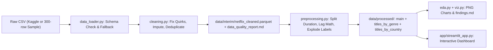

# How It Works: Architecture & Data Flow

This guide explains how data moves through the project—from a messy raw CSV file to clean tables, charts, and an interactive dashboard—and **why** each design decision was made.

---

## End-to-End Data Flow

---

## What Each Module Does

| Module | Responsibility |
| :--- | :--- |
| `src/netflix_analysis/config.py` | Stores all relative file paths, expected columns, maturity rating groups, and the colorblind-safe chart palette. |
| `src/netflix_analysis/data_loader.py` | Looks for `data/raw/netflix_titles.csv`, tries the Kaggle API if credentials exist, or falls back to `data/sample/netflix_titles_sample.csv`. |
| `src/netflix_analysis/cleaning.py` | Repairs misplaced ratings, drops critical nulls, fills metadata nulls with `"Unknown"`, strips whitespace, parses dates, deduplicates, and writes `reports/data_quality_report.md`. |
| `src/netflix_analysis/preprocessing.py` | Splits `duration` into numeric movie minutes and TV seasons, computes catalog lag, enriches `Audience_Group` & `Release_Decade`, and explodes `listed_in` and `country`. |
| `src/netflix_analysis/pipeline.py` | Command-line runner (`python -m netflix_analysis.pipeline`) that chains the stages together. |
| `src/netflix_analysis/eda.py` & `viz.py` | Generates colorblind-safe PNG charts and computes data-backed findings *(added in Phase 4)*. |
| `app/streamlit_app.py` | Interactive web dashboard for exploring the processed data *(added in Phase 5)*. |

---

## Why We Made Each Cleaning & Preprocessing Decision

### 1. Why fill `director`, `cast`, and `country` with `"Unknown"` instead of dropping rows?
Thousands of valid Netflix titles—especially TV shows and stand-up specials—do not list a single director. Dropping every row with a missing `director` would throw away ~30% of the catalog and bias our analysis toward movies! Filling with `"Unknown"` preserves every title while keeping filters working.

### 2. Why drop rows missing `date_added` or `rating`?
Only a tiny fraction of rows (~0.1–0.2%) lack `date_added` or `rating`. Since our timeline charts depend on `date_added` and our audience-profiling charts depend on `rating`, dropping those few incomplete rows keeps the charts accurate without distorting the dataset.

### 3. Why check for durations inside `rating`?
In the real Kaggle dataset, a few rows accidentally have `"74 min"` or `"84 min"` typed into `rating` with `duration` left blank. Moving those values back into `duration` recovers valid runtime data instead of treating `"74 min"` as an age rating.

### 4. Why deduplicate on `(title, release_year, director)`?
Regional re-releases or catalog re-imports occasionally create duplicate rows for the exact same title, release year, and director. Deduplicating prevents double-counting in genre and country totals.

### 5. Why split `duration` into `Movie_Duration_Min` and `TV_Seasons_Count`?
`"90 min"` (a movie) and `"2 Seasons"` (a TV show) measure completely different units! Keeping them in one text column makes math impossible. Separating them into two integer columns lets us calculate average movie length without mixing minutes and seasons.

### 6. Why explode `listed_in` (genres) and `country`?
If a co-production lists `"United States, United Kingdom"`, counting only the first country or keeping the combined string hides the UK's contribution. Exploding into `titles_by_country` and `titles_by_genre` ensures every country and genre is credited accurately.

### 7. Why keep negative `Addition_Lag_Years` values?
`Addition_Lag_Years = Year_Added - release_year` is usually `0` or positive (`0–1` years for Originals/new releases; `2+` years for older licensed films). Occasionally, a title has a negative lag (e.g., `-1`), meaning `Year_Added` is one year earlier than `release_year`—typically due to regional premiere timing or season-update metadata. We **preserve and flag** these rows as `"Negative Lag (<0 yr)"` rather than silently deleting them, so the numbers stay transparent.
